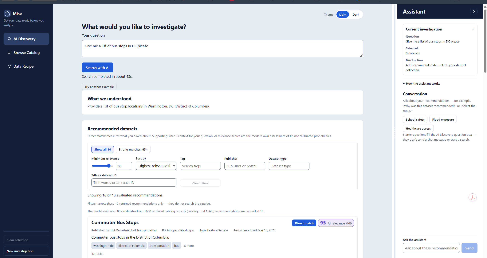
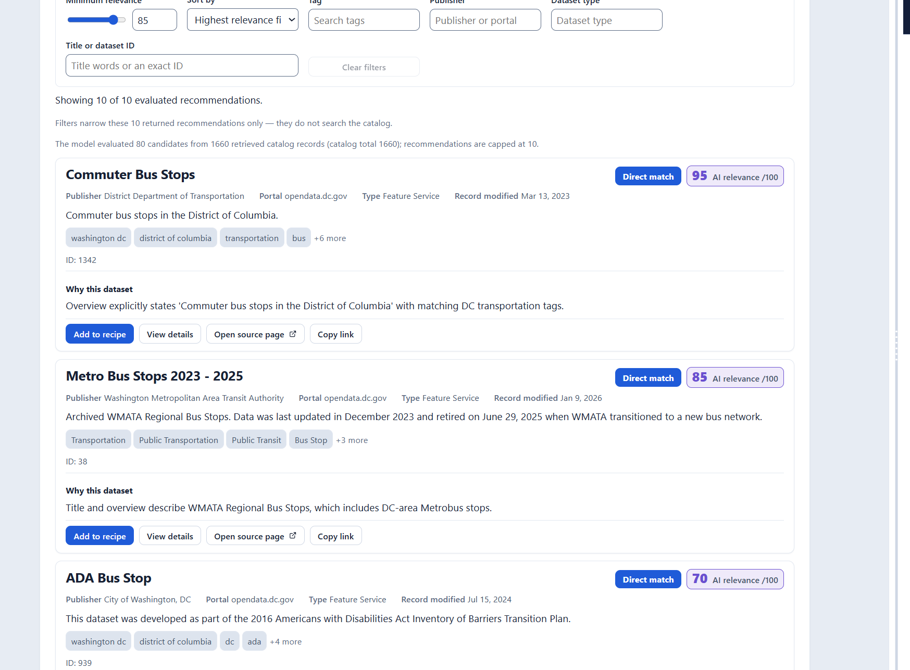
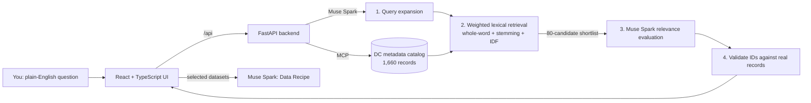

<div align="center">

# 🥣 Mise

### Ask a question about your city. Get the right open datasets and a plan to analyze them.

*Mise (from* mise en place*, "everything in its place") gets your data ready before you analyze.*


**[Demo video](#-demo)** · **[How it works](#-how-it-works)** · **[Run it locally](#-run-it-locally)**



</div>

---

## The problem

Washington, DC publishes **1,660+ open datasets**. If you're a student, a reporter, or a resident with a real question, like *"What affects pedestrian safety near schools?"*, keyword search buries you in aerial photos and zoning layers, and nothing tells you how the right datasets fit together.

## What Mise does

You ask in plain English. Mise searches the **entire DC catalog**, has **Meta Muse Spark** judge which datasets actually fit, explains each one, and turns your picks into a **Data Recipe**: a step-by-step analysis plan with joins, caveats, and data gaps that you can download.

| You ask | Mise finds (examples from real runs) |
|---|---|
| *What affects pedestrian safety near schools in DC?* | Safe Passage Routes (90), Crash Details Table (88), DC Public Schools |
| *Give me a list of bus stops in DC* | Commuter Bus Stops (95), Metro Bus Stops 2023–2025 (85), ADA Bus Stop (70), Shuttle Bus Stops (65) |
| *How is access to healthcare distributed across DC?* | Primary Care Facility (88), Healthcare for Homebound Older Adults (62) |

## ✨ Features

- **AI Discovery.** Ranked recommendations with a 0–100 relevance score, a *Direct match* or *Supporting* label, a plain-language "why", and stated limitations.
- **Real sources, always.** Every card links to the actual dataset page, service endpoint, publisher, and license. Mise never invents IDs, links, or data.
- **"How this search worked."** Every search shows the expanded search terms, how many records were searched, which candidates the model evaluated, and any fallback that was used.
- **An assistant that acts.** "Add the top 3 to my recipe" applies a validated change to your collection, with one-click **Undo**.
- **Data Recipes.** An analysis plan covering the objective, workflow steps, how the datasets relate, data gaps, limitations, and proposed outputs. Download it as **Markdown or JSON**.
- **Browse the full catalog.** Search all 1,660 records by title or exact ID, inspect full metadata, and build a collection by hand.
- **Built for real use.** Cancelable searches, saved workspaces, light and dark themes, keyboard-accessible resizing, and per-IP rate limits on AI endpoints.



## 🎬 Demo

> 📺 **Demo video:** _link coming soon_

1. Ask *"What affects pedestrian safety near schools in Washington, DC?"*
2. Review the ranked results, open **View details**, and check the real source link.
3. Ask the assistant: *"Add the top 3 to my recipe."*
4. Open **Data Recipe**, click **Generate**, then **Download Markdown**.

## 🧠 How it works



All runtime AI is **Meta Muse Spark** (`muse-spark-1.3`) via the Meta Model API:

| Step | What Muse Spark does |
|---|---|
| **Query expansion** | Turns the question into topical keywords and synonyms (*pedestrian safety → crash, crosswalk, sidewalk, vision zero*) and separates out place names |
| **Relevance evaluation** | Scores the shortlist against a rubric (topic fit, geographic and temporal fit, role, suitability) and explains every pick |
| **Data Recipe** | Writes the analysis plan from the selected datasets' metadata |
| **Assistant** | Answers questions about your investigation and proposes typed, validated actions |

### Technical decisions worth noting

**1. Two-stage retrieval keeps AI cost bounded as catalogs grow.**
Sending all 1,660 records to the model on every search would be slow and expensive, and wouldn't scale to state or national catalogs. Mise ranks every record locally first, then has Muse Spark evaluate only an 80-candidate shortlist. If the model times out, it retries once with the top 40 candidates and says so in the results.

**2. IDF weighting fixed a real failure.**
The first version used naive substring matching. Because every record mentions "Washington" and "DC", those words dominated the scores: *"pedestrian safety near schools in DC"* returned **zero** results, with the shortlist full of aerial photos. Mise now uses whole-word matching, light stemming (*schools → school*), and per-catalog [IDF](https://en.wikipedia.org/wiki/Tf%E2%80%93idf) weighting, so words that appear in more than 30% of records count for nothing. The same question now returns Safe Passage Routes and crash data at the top.

**3. The model can't make things up and get away with it.**
Every model response is schema-validated. Returned dataset IDs are checked against real catalog records, unknown IDs are dropped and counted, and malformed output gets one repair attempt. Assistant actions are validated against the current state before anything changes, and every change can be undone.

**4. Honest by design.**
Relevance scores are labeled as the model's own judgment, not probabilities. Archived datasets are still recommended, with their vintage noted. A recipe is clearly marked as a *proposed plan, not executed analysis*, and it lists what the data can't answer.

## 🚀 Run it locally

**Requirements:** Python 3.12, Node 20+, a [Meta Model API](https://dev.meta.ai) key.

```powershell
# 1. Backend
python -m venv .venv
.venv\Scripts\python.exe -m pip install -r backend/requirements.txt
copy backend\.env.example backend\.env      # then set MF_MODEL_API_KEY
.venv\Scripts\python.exe -m uvicorn app.main:app --app-dir backend --host 127.0.0.1 --port 8001

# 2. Frontend (second terminal)
cd frontend
npm install
npm run dev                                  # http://localhost:5173
```

**Or run it as one container:**
```bash
docker build -t mise .
docker run -p 8000:8000 -e MF_MODEL_API_KEY=your_key mise   # http://localhost:8000
```

**Tests:** `.venv\Scripts\python.exe -m pytest backend/tests -q` (backend, 180+ tests) and `cd frontend; npm run test:state` (workspace state).

Every setting is listed in `backend/.env.example`. The API key never reaches the browser and is never committed.

## 📁 Project structure

```
mise/
├── backend/
│   ├── app/
│   │   ├── retrieval.py     # whole-word + stemming + IDF candidate ranking
│   │   ├── expansion.py     # Muse Spark query expansion with fallback
│   │   ├── discovery.py     # search pipeline + model output validation
│   │   ├── recipe.py        # Data Recipe generation
│   │   ├── chat.py          # assistant replies + validated actions
│   │   ├── mcp_service.py   # metadata catalog client (MCP)
│   │   └── rate_limit.py    # per-IP limits + model concurrency cap
│   └── tests/
├── frontend/src/
│   ├── components/          # Discovery, Catalog, Recipe, Assistant
│   └── state/               # workspace store, persistence, Undo
└── Dockerfile
```

## ⚠️ Limitations

- **DC only, for now.** Mise searches opendata.dc.gov through the metadata MCP server.
- A search takes about **40–60 seconds**, mostly model time. It shows elapsed time and can be canceled.
- Retrieval is keyword-based plus AI expansion, so very unusual phrasing can still miss datasets. Use **Browse Catalog** to search every title directly.
- Relevance scores are the model's own assessment, not calibrated probabilities.

## 🗺️ Roadmap

- [ ] Add state portals, starting with one state, then national (data.gov)
- [ ] Persistent search index (PostgreSQL full-text search) refreshed in the background
- [ ] Hybrid keyword and semantic retrieval
- [ ] Shareable recipe links

## 🙏 Credits

- **Data:** [Open Data DC](https://opendata.dc.gov). Most DC GIS data is licensed [CC BY 4.0](https://creativecommons.org/licenses/by/4.0/); check each dataset's "Use limitations" in Mise.
- **AI:** Meta Muse Spark via the Meta Model API. The app was built with **Muse Code**.
- **Built for** the Meta Global AI Developer Hackathon 2026, Indie Developer track.

## License

[MIT](LICENSE)
