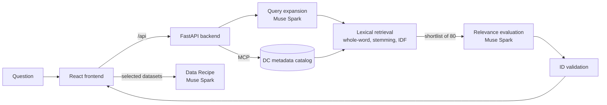

# Mise

Mise turns a plain-English question about Washington, DC into a shortlist of relevant open government datasets, then writes an analysis plan for the datasets you pick.

The name comes from *mise en place*, the cooking habit of prepping every ingredient before you start. Most of the work in a data project happens before any analysis: finding the right sources, checking what they actually contain, and figuring out how they fit together. Mise handles that part.

Built for the Meta Global AI Developer Hackathon (Indie track). All runtime AI is Meta's Muse Spark, and the app was built with Muse Code.


## Why I built this

DC publishes over 1,600 open datasets. When I tried to answer a simple question with them, like what affects pedestrian safety near schools, the portal's keyword search mostly returned aerial imagery and zoning layers. The useful datasets were there (crash records, Safe Passage routes, school locations), but finding them meant already knowing what to look for.

So I wanted a tool that starts from the question instead of the keywords, and that is honest about what the data can and can't tell you.

## What it does

1. **Discovery.** You ask a question. Mise searches the full DC catalog and returns ranked datasets, each with a relevance score, a short explanation of why it was chosen, and its limitations (archived, old, partial coverage, and so on).
2. **Inspection.** Every result links to its real source page, service endpoint, publisher, and license. You can open the full metadata before trusting anything.
3. **Assistant.** A side panel answers questions about your results and can change your selection when you ask ("add the top 3 to my recipe"). Every change it makes can be undone.
4. **Data Recipe.** From the datasets you select, Mise writes an analysis plan: objective, workflow steps, how the datasets relate, data gaps, and limitations. You can download it as Markdown or JSON.

A recipe is a plan, not a result. Mise never runs analysis or reports findings, and it never invents dataset IDs, links, or numbers.

Some real results from testing:

| Question | Top results |
|---|---|
| What affects pedestrian safety near schools in DC? | Safe Passage Routes (90), Crash Details Table (88), DC Public Schools |
| Give me a list of bus stops in DC | Commuter Bus Stops (95), Metro Bus Stops 2023–2025 (85), ADA Bus Stop (70) |
| How is access to healthcare distributed across DC? | Primary Care Facility (88), Healthcare for Homebound Older Adults (62) |


## How it works



The backend pulls the catalog from a remote metadata server over MCP and caches it. A search then runs in two stages.

**Stage 1: retrieval (local, no AI cost).** Muse Spark first expands the question into topical keywords, so "pedestrian safety" also searches for crashes, crosswalks, and Vision Zero. Then every record in the catalog is scored locally on whole-word matches in its title, tags, publisher, and description. The top 80 go on to stage 2.

**Stage 2: evaluation.** Muse Spark scores that shortlist against a rubric (topic fit, geographic and time coverage, whether the dataset answers the question directly or only provides context) and explains each pick. The backend then checks every returned ID against the real catalog and drops anything that doesn't match.

### Problems I ran into

**Everything matched "DC."** My first retrieval step used simple substring matching, so a query like "pedestrian safety near schools in Washington, DC" matched nearly every record, because nearly every record mentions Washington or DC. The 40-slot shortlist filled up with aerial photos and the model correctly reported that nothing fit. Switching to whole-word matching with IDF weighting (words that appear in more than 30% of records get zero weight) fixed it, and the same question now returns crash and Safe Passage data at the top. Small catalogs skip the zeroing so tests and tiny datasets still work.

**The model was too strict.** Early prompts told the model that fewer, stronger matches were better, so it would return nothing for "how many bus stops are in DC?" because the best match was labeled archived. I changed the rubric so archived or partial datasets are still recommended, with the caveat written into their limitations.

**The assistant said it did things it didn't do.** Sometimes Muse Spark would reply "Adding the top 3 datasets…" without sending the structured action that actually changes the selection. I added a small parser for unambiguous commands (add/remove the top N, clear, undo) as a fallback, and a rule that replaces any reply claiming a change that wasn't applied.

**Timeouts and truncation.** Scoring 80 candidates sometimes takes longer than the request timeout, so the backend retries once with the top 40 and says so in the "How this search worked" panel. Muse Spark's reasoning also counts against the output token limit, which caused truncated JSON until I raised the limit and capped results at 10.

### Guardrails

- Model output is schema-validated, and malformed responses get one repair attempt before an error is shown.
- Assistant actions are validated against the current state before anything changes, and each one can be undone.
- The AI endpoints have per-IP rate limits and a cap on concurrent model calls.
- The API key stays on the server. It is never sent to the browser or committed.

## Running it locally

You need Python 3.12, Node 20+, and a Meta Model API key.

```powershell
# backend
python -m venv .venv
.venv\Scripts\python.exe -m pip install -r backend/requirements.txt
copy backend\.env.example backend\.env      # add MF_MODEL_API_KEY
.venv\Scripts\python.exe -m uvicorn app.main:app --app-dir backend --host 127.0.0.1 --port 8001

# frontend, in a second terminal
cd frontend
npm install
npm run dev                                  # http://localhost:5173
```

Or as a single container:

```bash
docker build -t mise .
docker run -p 8000:8000 -e MF_MODEL_API_KEY=your_key mise
```

Tests: `.venv\Scripts\python.exe -m pytest backend/tests -q` for the backend and `npm run test:state` in `frontend/` for the workspace state logic.

All configuration is documented in `backend/.env.example`.

## Project layout

```
backend/app/
  retrieval.py     candidate ranking (whole-word, stemming, IDF)
  expansion.py     query expansion with fallback
  discovery.py     search pipeline and output validation
  recipe.py        Data Recipe generation
  chat.py          assistant replies, actions, intent fallback
  mcp_service.py   metadata catalog client
  rate_limit.py    rate limiting and model concurrency
frontend/src/
  components/      Discovery, Catalog, Recipe, Assistant
  state/           workspace store, persistence, undo
```

## Limitations

- Only DC's catalog (opendata.dc.gov) is supported right now.
- A search takes roughly 40–60 seconds, almost all of it model time.
- Retrieval is keyword-based with AI expansion, so unusual phrasing can still miss things. Browse Catalog searches every title directly as a backup.
- Relevance scores are the model's judgment, not calibrated probabilities.

## What's next

The main goal is adding more catalogs, starting with one state portal and then data.gov. That means moving from an in-memory cache to a real search index (probably PostgreSQL full-text search, refreshed in the background), keeping dataset IDs unique across sources, and separating a dataset's geographic coverage from where its publisher is located. After that, I'd like to try hybrid keyword and semantic retrieval for questions that use different wording than the metadata.

## Credits

Dataset metadata comes from [Open Data DC](https://opendata.dc.gov). Most DC GIS data is published under [CC BY 4.0](https://creativecommons.org/licenses/by/4.0/); check each dataset's use limitations before using it.

AI features use Meta Muse Spark through the Meta Model API. Built with Muse Code.

## License

MIT
